<p align="center">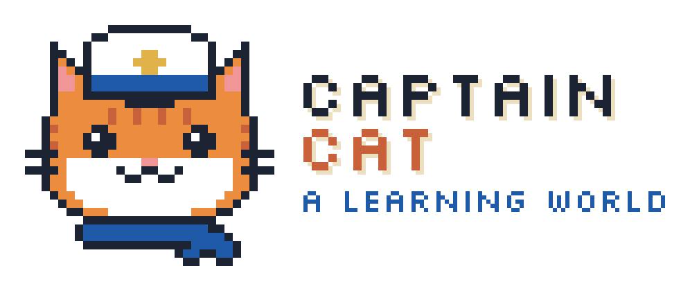</p>

# Captain Cat

> A learning world. Your courses, turned into islands you explore: a GenAI peer-learning companion for
> university students, built for the EdNova "GenAI Peer Learning Companion" technical challenge
> (IEEE WIE ACT 5.0).

<p align="center">
  <a href="docs/report/video/final-subtitled.mp4"><b>▶ Watch the 90-second demo</b></a> ·
  <a href="#screenshots">Screenshots</a> ·
  <a href="#genai-module-technical-explanation">GenAI module</a> ·
  <a href="#setup">Setup</a> ·
  <a href="docs/report/REPORT.md">Report</a>
</p>

<p align="center">
  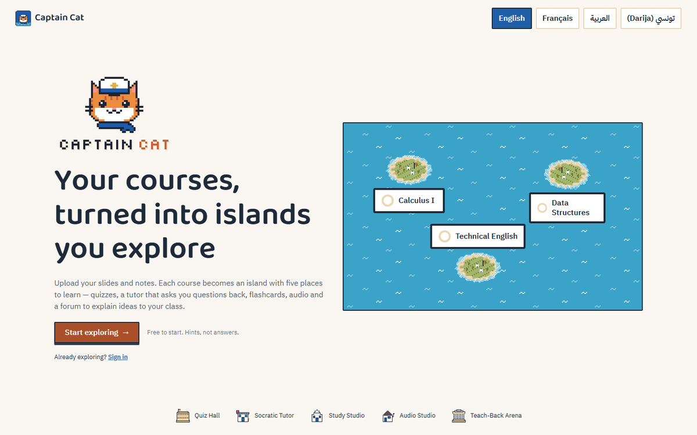
  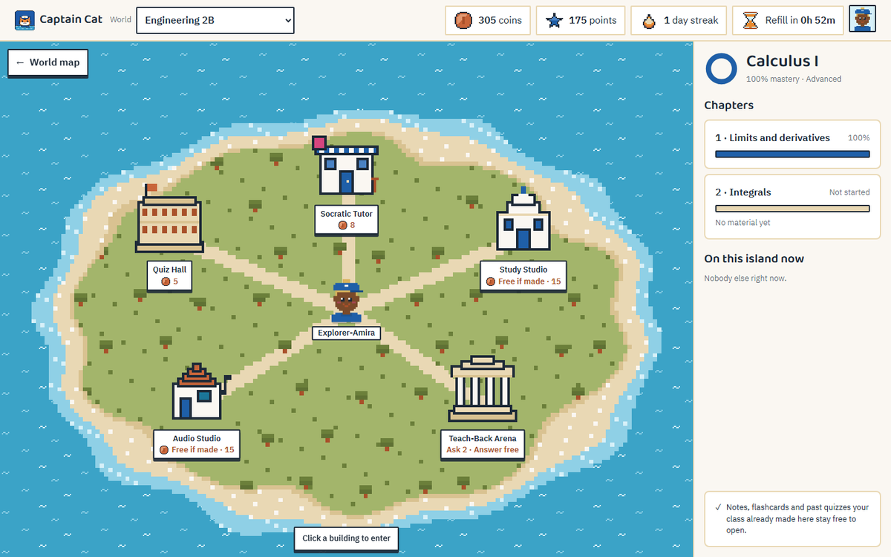
</p>

**Languages:** English · Français · العربية · تونسي (Darija), with a full right-to-left layout for
Arabic and Darija. **Models:** the EdNova platform's open-source models (compact `llama3.2-3b`, mid
`llama3.1-8b`), routed per task.

## What it does

Upload your course material once, and every classmate who joins your world gets the same islands.
Each island has five buildings:

| Building | What the student gets | AI behind it |
| --- | --- | --- |
| **Quiz Hall** | 10 questions from the chapter; a hint and a second try before any explanation | 1 compact call per set, shared by the class |
| **Socratic Tutor** | Guiding questions, never the final answer; hint counter, "ideas found", session summary | compact turns; mid only after 2 × "I'm stuck" (escalation) |
| **Study Studio** | Notes with page refs, flashcards (spaced repetition), mind map | 1 mid + 2 compact per pack, then free for the class |
| **Audio Studio** | A spoken episode of the chapter (browser voices), transcript and speed | 1 mid call per episode, then free |
| **Teach-Back Arena** | Explain to classmates; answers are AI-scored, the asker pins the best | compact grades; mid reviews only uncertain or borderline scores (Arabic and Darija: mid grades directly) |

Mistakes that several classmates share become anonymous **Class Wisdom** tips, written once by
the mid model in every language of the class. A **daily plan** (3 challenges) is written once per
student per day. Coins (free daily refill, earned, optional purchase) pay for new AI work; anything
the class already made is free. The UI is in English, French, Arabic and Tunisian Darija (RTL).

Challenge fit: `docs/PRODUCT.md` → Challenge fit.

## Screenshots

| | |
| --- | --- |
| 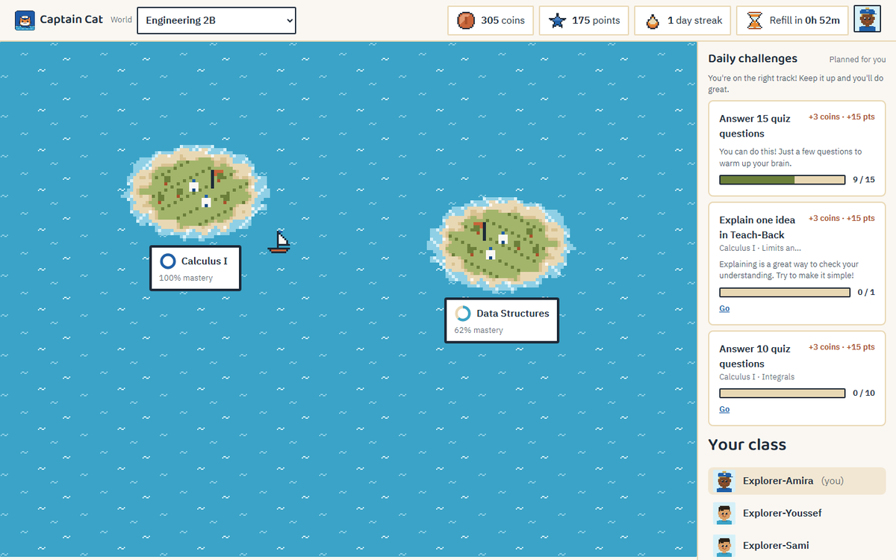 | 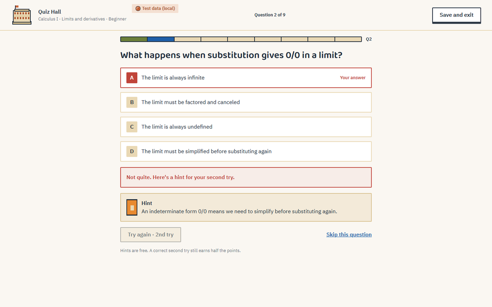 |
| **World map:** one island per course, with mastery rings, coins, streak and the daily plan | **Quiz Hall:** a wrong answer gets a hint and a second try before any explanation |
| 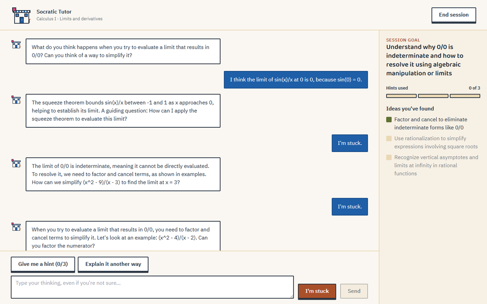 | 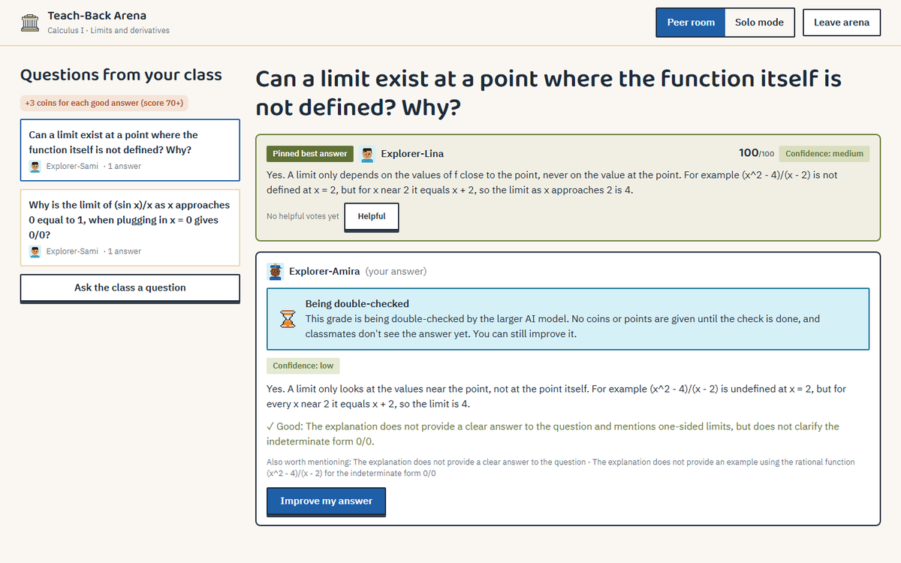 |
| **Socratic Tutor:** guiding questions, never the final answer; hint counter and "ideas you've found" | **Teach-Back Arena:** explain to classmates; AI score and feedback, the asker pins the best answer, unsure grades wait for a mid-model review |
| 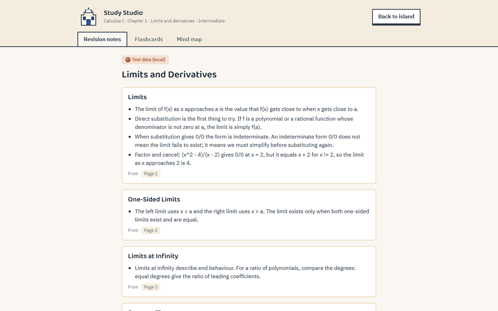 | 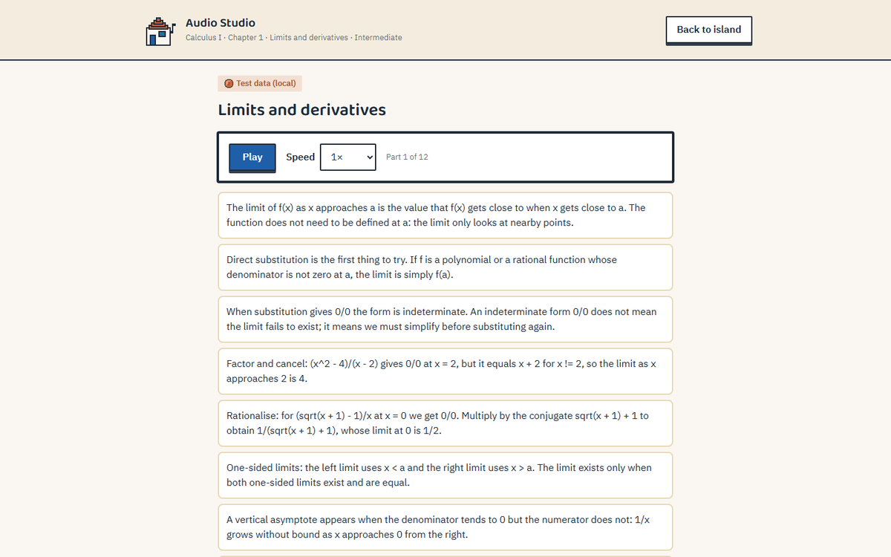 |
| **Study Studio:** notes with page references, flashcards, mind map; made once, free for the class | **Audio Studio:** a spoken episode of the chapter (browser voices), transcript and speed |
| 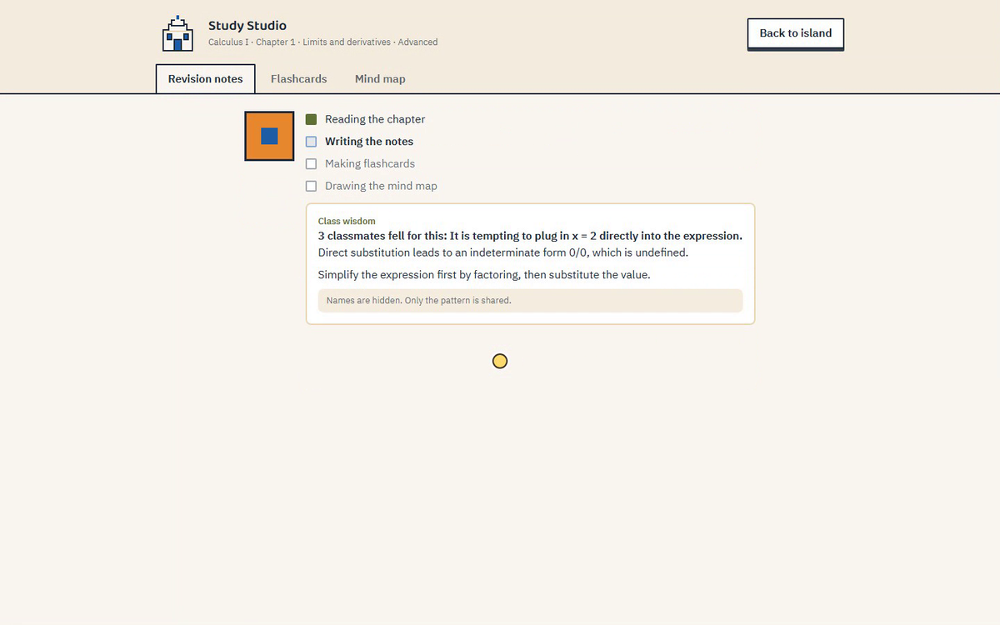 | 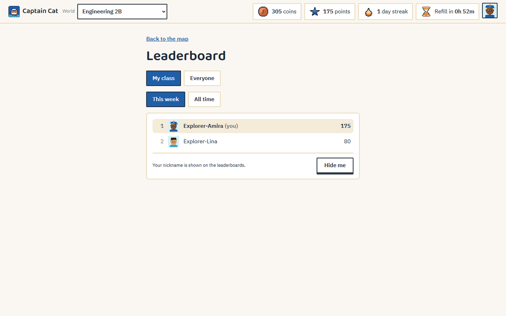 |
| **Waiting is part of the design:** real job stages from the backend, and a Class Wisdom tip from classmates' shared mistakes | **Leaderboard:** class or everyone, this week or all time; one tap hides you |

<p align="center">
  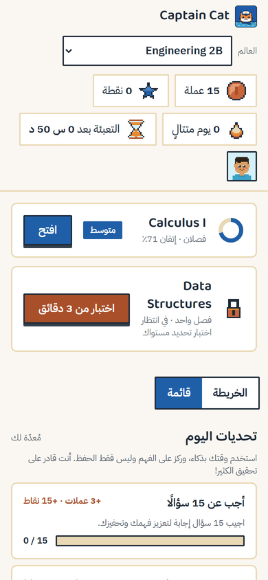
  &nbsp;
  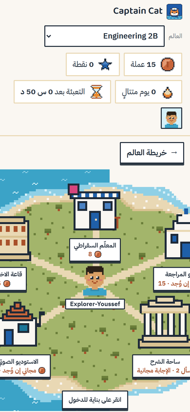
</p>
<p align="center"><sub>Arabic on a phone (390 px): mirrored layout, logical CSS properties throughout.</sub></p>

<sub>The screens were captured from our dev stack after the platform time slots closed, so the AI
content in them comes from our local open-source models, and the app labels it "Test data
(local)". The cloud cache only ever serves platform-generated content.</sub>

## GenAI module (technical explanation)

The platform is CPU-only, has no streaming, allows 2 concurrent requests and ~20 requests/min per
key, and mid-size compute is the scarce resource. Everything below follows from those limits.
Details: `docs/PLATFORM.md` (limits and the error contract) and `docs/ARCHITECTURE.md` (routing
table, data model).

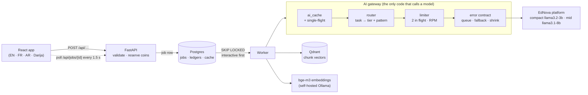

**One gateway.** Every LLM and embeddings call goes through `backend/app/gateway/`:
cache → priority queue (interactive before background) → limiter (2 in flight, `LLM_MAX_RPM`) →
OpenAI-compatible client (no SDK retries) → error-contract handling → `ai_call_log`. Features never
pick a model: `router.py` maps each task kind to a tier and an orchestration pattern.

**Every AI action is a job.** The API validates, reserves coins and queues a row in `jobs`. One
worker process runs it, and the browser polls `GET /api/jobs/{id}` every 1.5 s for real stages,
queue position and ETA. Coins are committed on success and refunded on failure.

**Models** (in-slot probe, `docs/MODELS.md`): compact `llama3.2-3b`, mid `llama3.1-8b`.

**Orchestration patterns, and where each one is used**

| Pattern | Used for |
| --- | --- |
| escalation | Tutor turns: compact by default, mid only when the student is stuck |
| draft-then-revise | Teach-Back grading: compact drafts; mid reviews low-confidence or borderline scores. Arabic and Darija go straight to mid (the compact model is unreliable there); a grade still unsure pays nothing until it's reviewed |
| plan-once / execute-compact | Study pack: mid writes the notes once, compact turns them into cards and a map; daily plan |
| narrow-before-generating | Quiz sets, notes, audio scripts: vector search on the chapter, then only the relevant chunks reach the model |
| fallback | Any mid task when mid is saturated → compact, shown as a "Quick mode" badge |

**Request economy** (measured on the mock; one request = one quota unit):
a 30-page PDF + a 12-slide PPTX index with 6 tagging calls (8 chunks per call) + 2 embeddings calls
(32 texts per call); a quiz is 10 questions in one call; a study pack is 1 mid + 2 compact calls
for the whole class; a Class Wisdom tip is one call for every language of the class.
Shareable outputs are cached per `world, chapter, level, language`, the daily plan is cached on
its full prompt (which holds no identity), and identical requests in flight are single-flighted.
Repeated identical requests, measured on the mock on 5 Nov 2026 after 32 browser students, the
fault probes and a 30-job load test: **0 in our call log**; an independent proxy in front of the
mock saw **2**, both retries of one request that we deliberately made time out (the server still
answered after our 90 s timeout). Before the audit fix the same kind of run gave 37, 30 of them
daily plans (`docs/report/AUDIT.md`, F-CACHE-1).

**Error contract → behaviour** (`backend/tests/test_gateway_contract.py` covers every row)

| Platform says | We do | Student sees |
| --- | --- | --- |
| quota exhausted + delay | requeue the job with `not_before` | "High demand, your quiz is in line (about N s)" |
| 503 + Retry-After (mid busy) | interactive: one retry, then compact; background: retry later | "Quick mode" badge |
| 400 beyond a ceiling | shrink `max_tokens` / chunks / history, resend once | nothing, or a shorter answer |
| 401 outside our slot | offline demo mode | banner; saved results open, new AI actions paused, no coins move |
| identical request | `ai_cache` hit, no call | instant |

**Resilience under load.** `scripts/load.py` fires N jobs at once with 503 and quota faults. Last
runs: 30/30 jobs done, never more than 2 calls in flight, every fault handled; interactive p50 38 s
against background 126 s on the slow mock. The final forced-503 job always falls back to compact.

**RAG.** PDF, PPTX, DOCX, TXT and images (Tesseract OCR, `ara+fra+eng`, for scanned pages) →
~2,000-character chunks that never cross a page or slide, so every chunk keeps a reference
(`page:12`) → compact concept tags → embeddings (our own Ollama with `bge-m3`, multilingual:
our platform key has no embeddings model) → Qdrant (one collection per provider, payload
filters on world, course and chapter). Text stays in Postgres.

**Prompts** live in `backend/app/prompts/*.md` (versioned, multilingual). The tutor's
answer-leak guard rewrites a reply that gives the answer away into a guiding question.

**Admin side.** `/admin` (English, works on a phone) exists only when `ADMIN_TOKEN` is set: the
token is exchanged once for an 8-hour HttpOnly cookie and is never stored in the page. It has
**Switches** (force Quick mode for a few minutes, offline demo mode, pause the background lane,
lower the request rate; applied by the API and the worker within ~3 s), **Stats** (the
organisers' metrics: calls per model, compact/mid split, tokens, cache hits, repeated identical
requests, refusals, real fallbacks and, apart, forced Quick mode), read-only pages for users,
worlds, content, the arena, jobs, the AI cache and the admin log, and changes to all of them.
Every coin or point change is a ledger row; every admin change is logged with a reason in
`admin_actions`; deletes need a dry run and the name typed. `python3 scripts/export_stats.py`
(with `ADMIN_TOKEN` in its environment) writes the stats to `docs/report/`. Set up: `docs/DEPLOY.md` §6.

## Setup

```bash
cp .env.example .env            # the key goes in CLOUD_API_KEY, in .env only; never commit .env
docker compose up --build       # db, qdrant, mock-llm, backend, worker, frontend
```

Open http://localhost:5173 (app), http://localhost:5173/styleguide (design system; `?compare=1`
shows English and Arabic side by side) and http://localhost:8000/api/health (`"status": "ok"`).
Migrations run automatically when the backend container starts.

**Demo world:** `docker compose exec backend uv run python -m app.seed` (synthetic CC0 material:
a 30-page Calculus PDF with one scanned page, a Data Structures PPTX, a Word exercise sheet and a
photo of the board). Join code `OLIVE-7Q2`. Create your own world at /worlds/new.

**Providers:** `LLM_PROVIDER` in `.env` = `mock` (default, no key needed), `local` (Ollama, dev
only), `cloud` (the EdNova platform, during our time slot only) or `auto`. Production accepts only
`cloud`; outside our slot it runs in offline demo mode. `python3 scripts/slot.py` says whether our
key is live, and `python3 scripts/llm.py use|status|check` switches and inspects the provider.

**Windows:** run Docker Desktop first. Git Bash and PowerShell both work (`copy .env.example .env`
in cmd). The repo forces LF line endings, so the Linux images build unchanged.
**If `pnpm install` times out** (some networks block `registry.npmjs.org`):
`NPM_REGISTRY=https://registry.yarnpkg.com/ docker compose up --build`.

Without Docker (dev loop):

```bash
docker compose up -d db qdrant mock-llm
cd backend && uv sync && uv run alembic upgrade head && uv run uvicorn app.main:app --reload
cd backend && uv run python -m app.worker
cd frontend && pnpm install && pnpm dev
```

**Deploy:** Railway (API + worker + Postgres) and Vercel (frontend). See `docs/DEPLOY.md`.

## Tests

```bash
cd backend && uv run ruff check . && uv run pytest -q          # 529 tests, mock platform in-process
cd frontend && pnpm lint && pnpm typecheck && pnpm test --run && pnpm i18n:check   # 93 tests, 828 keys × 4
cd backend && uv run python ../scripts/load.py --jobs 30       # against the running stack
cd backend && uv run python -m app.evals slot                  # every AI feature × 4 languages, saved for review
```

No `uv` or `node_modules` on the host? Run the same checks inside the compose containers
(`CLAUDE.md` → Commands). CI runs gitleaks, the constraint greps, backend, mock-llm and frontend.

## Privacy & ethics

Nicknames only: no real names, photos, voices, ages, genders or addresses are collected. The
profile holds level, learning style and goals only, so the AI can't treat students differently
by gender, region, language level or background. Peer posts are moderated, and shared mistakes
become tips with no nicknames in the prompt. The tutor gives hints before answers and supports
the teacher; it doesn't replace them. Demo material is synthetic or openly licensed. The API key
lives only in `.env` (gitignored) and the deploy's secret settings.

## Declared external services

Tesseract OCR (local) · Qdrant (self-hosted in dev; Qdrant Cloud for the demo unless the platform's
Qdrant is reachable) · PostgreSQL · browser Web Speech API (client-side voices) · Ollama (chat models dev only;
`bge-m3` embeddings in production, since our key has none) · hosting on Vercel and Railway. No other LLM or AI API is used.
The full list is in `docs/DECISIONS.md`.

## Brand

<p align="center">
  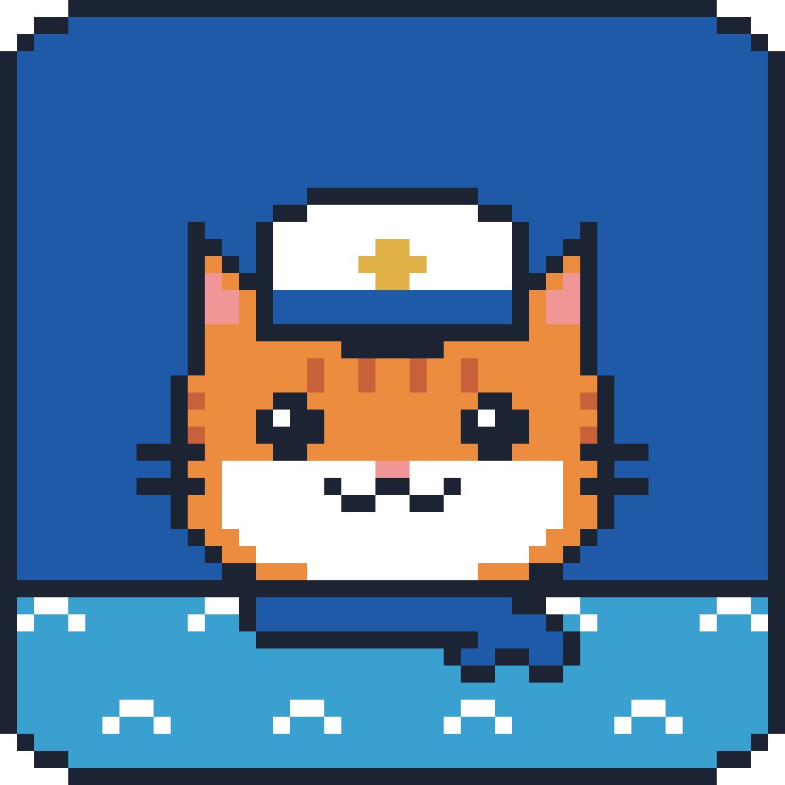
  &nbsp;&nbsp;
  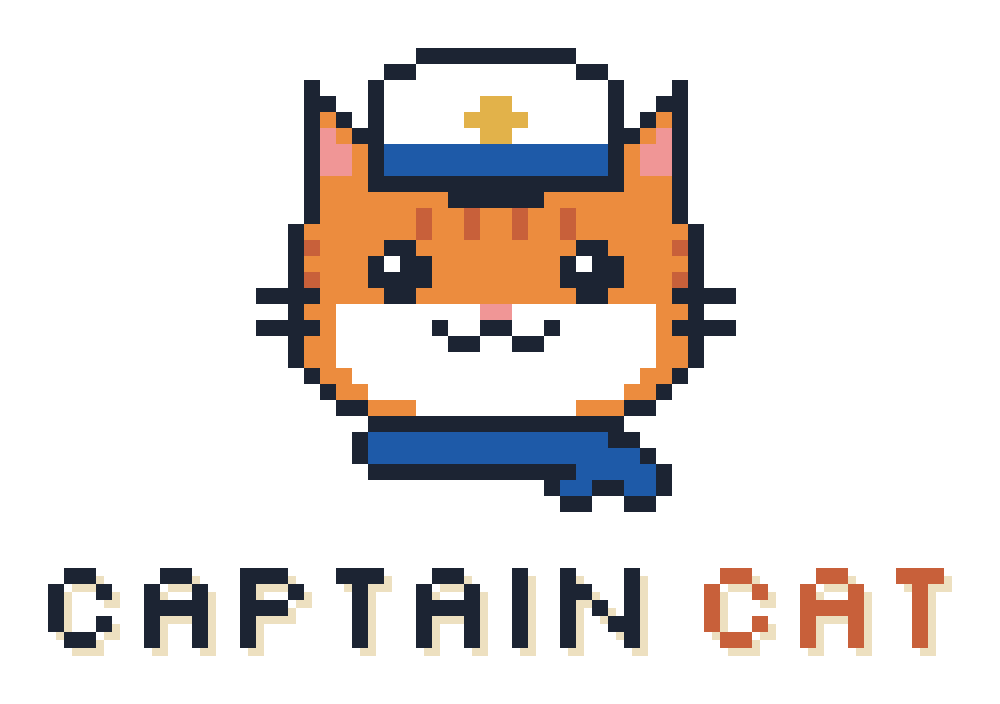
</p>

Pixel-art logo system (primary, horizontal, app icon, badge) and palette sheet in
`design/assets/brand/`; favicon and touch icons in `frontend/public/`.

## Docs

`docs/PRODUCT.md` (features, flow) · `docs/ARCHITECTURE.md` · `docs/PLATFORM.md` ·
`docs/MODELS.md` · `docs/ECONOMY.md` · `docs/DESIGN.md` · `docs/DECISIONS.md` ·
`docs/BUILD_PLAN.md` · `docs/DEPLOY.md`
